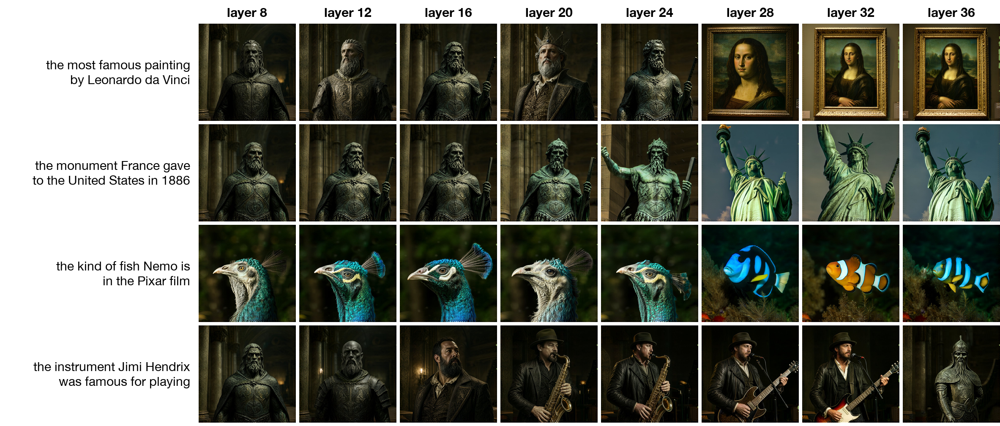

# vlens

vlens turns one hidden activation of a language model into a picture, with no text anywhere in the image path. The same
model then looks at the picture, and its new activation is compared directly with the original one.

The source and reader is Qwen3-VL-4B-Instruct, a vision-language model. The image generator is FLUX.2 [klein] 4B, a
4-step distilled rectified-flow model that normally reads the hidden states of a Qwen3 text encoder. In vlens klein
gets no prompt and no word embeddings. A small trained adapter computes klein's entire conditioning from the activation.

## Pipeline

1. **Activation.** Qwen3-VL's residual stream after decoder layers 9, 18 and 27 (pre-norm), taken at the last
   position of the reply start and concatenated: 3 x 2560 = 7,680 numbers.
2. **Adapter.** It maps that vector to 64 conditioning tokens of size 7,680, written on top of klein's blank
   conditioning (the encoding of an empty prompt, one constant), as the sum of three parts:
   - a free bias, which carries whatever all pictures share;
   - a direct path that is linear in the standardized activation with no biases (activation -> 1,024 -> 64 tokens of
     256 -> 7,680 per token, last layer zero-initialized). It averages exactly zero over training items, so it can only
     carry what differs between them and every gradient it gets is item-specific;
   - a MetaQuery-style path for nonlinear structure: the activation becomes 8 tokens, 64 learned queries attend to them
     through a 4-layer transformer, and a zero-initialized projection writes the result.

   The first version had only the MetaQuery path. Its outputs for different activations pointed 92% in the same
   direction, and with every loss tried it learned one shared conditioning that ignored the activation.
3. **Picture.** Klein (frozen) runs its own 4-step Euler sampler at 384 px from that conditioning.
4. **Readback.** Qwen3-VL reads the picture in the same context the source activation came from, with the picture in
   place of the content:
   - a caption chat "Picture this scene in your mind: {caption} ..." becomes "... in your mind: [picture] ...";
   - a character chat "You are {x}. ..." becomes "You are [picture]. ...".

   The new activation is compared with the source activation directly, after standardizing each dimension by its
   training mean and spread (fixed constants). No probe or readout is fitted.

## Sources of activations

| source | what Qwen3-VL gets | ground truth |
|---|---|---|
| `see` | a real photo (COCO or CC3M) and "keep it in mind, just reply OK"; no caption anywhere | the photo |
| `inj` | a text-only chat with no image and no description. The see context's states at the 5 reply-start positions after layer 8 are copied in, bypassing tokens, and the model computes on from there | the photo |
| `hold` | the photo's caption in a text-only chat, under 7 training wordings and 2 test wordings | the photo |
| `char` | "You are <character>" chats (264 characters, 53 held out) | none |

## Training

- **Stage B (oracle style, supervised), end to end.** The adapter's conditioning goes through klein's 4 sampling
  steps and the VAE decoder with gradients on; the picture is compared with the real photo in DINOv2-base features
  (1 - cosine of the class tokens, plus the mean over the 256 patch tokens of 1 - cosine, so both content and layout
  count). Klein is frozen and only its conditioning is trained, so every picture is a klein picture.
  - A flow-matching prior on the undistilled klein base 4B (same architecture and conditioning space) keeps the
    conditioning in the region klein draws photos from.
  - Flow matching alone did not work. On the step-distilled klein its error against a real photo is lowest for
    conditionings that make it draw a blurry average (at the first step the blank conditioning scored 1.10, the true
    caption 1.58), and the adapter learned exactly that, one average-photo conditioning that ignored the activation.
    On klein base the true caption beats the blank conditioning at every noise level, but the per-sample signal is
    small (true caption vs a shuffled one: 0.037), and in 500 steps the adapter's gain over shuffled pairs was 0.0001.
  - Held-out checks: the flow-matching loss and the DINOv2 loss of 8 test items per source, each with its gain over
    shuffled activation-photo pairs.
- **Stage C (NLA style, unsupervised reconstruction added).** The adapter makes a picture through klein's 4 sampling
  steps and the VAE decoder, and Qwen3-VL reads it back in the source's own context; gradients flow through all of
  these.
  - The loss is the mean squared error between the standardized readback and source activations: the picture must
    let the model rebuild its own activation.
  - This loss needs no photo or label, so character activations train on it alone.
  - The stage B loss stays on, to keep pictures natural and to limit hiding information in pixel patterns that only
    the reader decodes.

## Evaluation

- **Test sets.** 1,000 held-out photos (500 COCO, 500 CC3M) under 4 sources, plus 53 held-out characters.
- **Reconstruction.** Fraction of variance explained between the readback and the source activation (standardized).
  Two references: the real photo read back in the same context (how much any picture could explain), and shuffled
  pairs (no item information).
- **Readback rank.** The source's rank among all 1,000 sources.
- **SigLIP 2 rank.** The real photo's rank among the 1,000 real photos by SigLIP 2 (so400m/16-512) image-image
  similarity. No stage trains on this scorer.
- **Text route.** Klein given the caption as an ordinary prompt: the text-bottleneck reference.
- **Robustness.** Each picture is read back again after degradations a viewer barely notices (256 px JPEG, JPEG
  quality 30, half resolution), with real photos degraded the same way as the reference. If a picture's
  reconstruction falls much further than the real photos' does, its information sits in pixel patterns that only the
  reader decodes, not in the scene.
- **Prior control.** Random activations with the same per-dimension mean and spread as real ones. If these also
  produce confident, meaningful scenes, the pictures reflect klein's prior rather than Qwen's state.

## A real LLM's own states, no training (`vlens native`)

Qwen-Image-2.1 (Alibaba, September 2026) generates pictures from the last-layer states of Qwen3-VL-8B, and its encoder
is the public Qwen3-VL-8B-Instruct checkpoint (checked tensor by tensor). When the pipeline edits a photo, the photo's
own positions are replaced by its VAE latents, so Qwen3-VL's states at the image tokens never reach the generator;
only its states at the text positions do, including the positions after the photo, which have attended to it.
- **States only, no pixels:** Qwen3-VL-8B looks at a photo inside the pipeline's edit template; the generator gets
  only its last-layer states at the text positions. With the vlens see prompt after the photo (33 positions) the
  pictures come back as the photo's scene: a motorcycle rider, a long-haired girl, a kitchen, wooden spoons,
  bathrooms (first 8 test photos in order, 7 recognisable). The last 5 positions alone keep much less.
- **Concept steering:** + s x (typical state size) along a concept direction after layer 18, at every position of a
  blank prompt (the direction: mean reply-start state of photos whose captions name the concept minus that of all
  photos; the raw gap is only 2-4% of the state size, which is why fixed multiples of it changed nothing). At s = 1
  the dog, cat and horse directions draw a dog, a cat and a rider on a horse; s = 4 gives noise. Asked what it is
  thinking about in the same steered state, Qwen3-VL-8B names the concept for 8 of 16 ("You're thinking about the
  dog", "Boeing 737 MAX 8", "British Rail Class 47 Locomotive", "A small boat on a calm sea").
- **Neuron steering:** the single MLP neuron of layer 18 that best separates those photos, raised until its write
  has the same size: no recognisable effect on pictures or words.

Every picture in a row uses the same noise.

## Adapter into Qwen-Image-2.1 (`vlens qimg`)

The states-only result gives an adapter an exact per-photo target: Qwen3-VL-8B's states after it looked at the photo,
which the generator draws from. `vlens qimg` fits ridge maps (closed form, per source kind) from Qwen3-VL-4B's
reply-start activation (see, inj, hold) to those states and draws with the untouched Qwen-Image-2.1-Turbo. The pictures
are scored by the SigLIP 2 rank of the true photo and by readback rank among the test photos, against the 8B's own
states (ceiling) and the mean target (collapse control).

First run (6,000 COCO training photos, 100 held-out test photos, 512 px; SigLIP 2 top-1 / top-5 among the 100, chance
1% / 5%):

| pictures drawn from | top-1 | top-5 | median rank |
|---|---|---|---|
| Qwen3-VL-8B's own states (ceiling) | 43% | 76% | 1 |
| Qwen3-VL-4B sees the photo | 29% | 67% | 2 |
| Qwen3-VL-4B's reply-start states moved into a chat with no photo (inj) | 20% | 49% | 6 |
| Qwen3-VL-4B reads only a caption (hold) | 13% | 33% | 9 |
| the mean target (draws the same dog every time) | 1% | 5% | 49 |

Every klein connector before this (flow matching on the distilled or the base model, end-to-end DINOv2 through the
4 steps, a direct linear path) learned one conditioning for every activation.

## A picture lens across depth (`vlens depth`)

A tuned lens with a picture as the readout. For each layer L of Qwen3-VL-8B, a ridge map carries the layer-L state at
a position to the last-layer state at the same position (fit on 137,601 token pairs from 4,000 contexts, photos and
captions; held-out fit 0.89 at layer 4 to 0.96 at layer 32). The untouched Qwen-Image-2.1-Turbo then draws the mapped
states. Prompts are "Think of X. Don't name it or describe it. Just reply OK.", and only the positions after "X." are
drawn, so the generator never reads the words. 48 answers are each named ("Think of the Mona Lisa.") and described in
two steps ("Think of the most famous painting by Leonardo da Vinci."). A picture is scored by the SigLIP 2 rank of its
label among the 48 (chance 2%).



| top-1 among 48, by layer | 8 | 12 | 16 | 20 | 24 | 26 | 28 | 30 | 32 | 34 | 36 (last, no map) | 28, no map |
|---|---|---|---|---|---|---|---|---|---|---|---|---|
| named | 2% | 15% | 4% | 6% | 6% | 27% | 44% | 56% | 54% | 56% | 46% | 67% |
| described in two steps | 10% | 10% | 8% | 6% | 17% | 23% | 29% | 38% | 35% | 35% | 31% | 33% |

Both kinds become drawable at about the same depth, from layer 26-28 on, and stay more drawable at layers 30-34 than
at the last layer, where the empty-state picture (a robed statue) often returns. Two-step answers are drawn less
often, not later: 27 of 48 named answers and 17 of 48 two-step answers stay top-1 from some layer through layer 34,
and for the 15 answers that do both, the two-step one arrives 0.4 layers later on average (95% bootstrap interval -1.9
to 2.4). Single examples look like a sequence (Jimi Hendrix's instrument is a man with a saxophone at layers 20-24 and
an electric guitar at 28-32; the Nemo description draws a peacock through layer 24, a blue fish at 28 and a clownfish
at 32), but the paired counts do not show two-step answers forming later. Layer 28's states drawn with no map beat
every mapped layer on named objects (67%) but not on photos (25% against 50% mapped), so the maps, fit on photo and
caption positions, lose part of what these positions hold.

## Run

```
pip install -e .
scripts/test_tiny.sh                      # every stage in minutes, small random Qwen3-VL (plumbing only)
scripts/run_all.sh /data/work /data/run   # full run on one 80 GB GPU, about 4 hours on an A100
```

All models and data are public: Qwen/Qwen3-VL-4B-Instruct, black-forest-labs/FLUX.2-klein-4B and FLUX.2-klein-base-4B (Apache 2.0), facebook/dinov2-base,
google/siglip2-so400m-patch16-512, yerevann/coco-karpathy (COCO image URLs), pixparse/cc3m-wds.

## Status

The first full run is in progress. Results will be added here.
