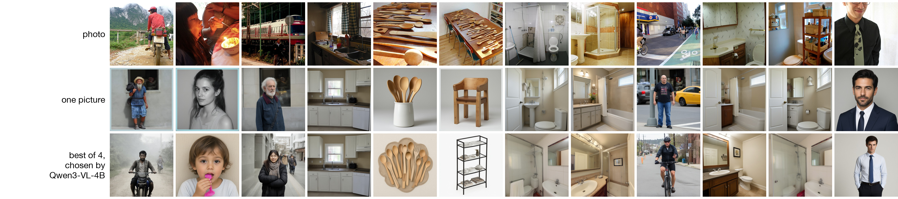
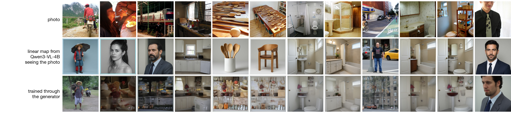
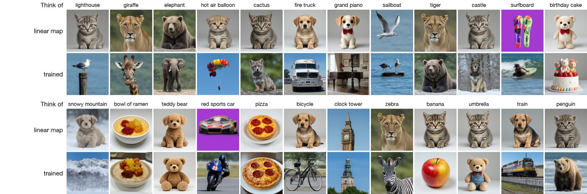
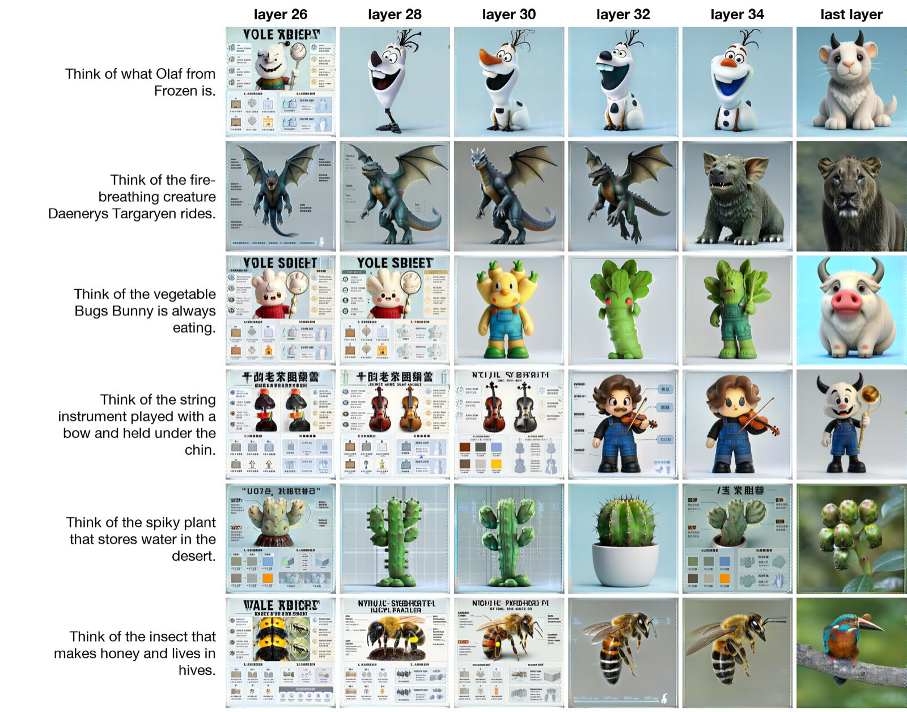

# vlens

vlens turns one hidden activation of a language model into a picture, with no text anywhere in the image path. The same
model then looks at the picture, and its new activation is compared directly with the original one.

The source and reader is Qwen3-VL-4B-Instruct, a vision-language model. The image generator is FLUX.2 [klein] 4B, a
4-step distilled rectified-flow model that normally reads the hidden states of a Qwen3 text encoder. In vlens klein
gets no prompt and no word embeddings. A small trained adapter computes klein's entire conditioning from the activation.

## Pipeline

1. **Activation.** Qwen3-VL's residual stream after decoder layers 9, 18 and 27 (pre-norm), taken at the last
   position of the reply start and concatenated: 3 x 2560 = 7,680 numbers.
2. **Adapter.** It maps that vector to 64 conditioning tokens of size 7,680, written on top of klein's blank
   conditioning (the encoding of an empty prompt, one constant), as the sum of three parts:
   - a free bias, which carries whatever all pictures share;
   - a direct path that is linear in the standardized activation with no biases (activation -> 1,024 -> 64 tokens of
     256 -> 7,680 per token, last layer zero-initialized). It averages exactly zero over training items, so it can only
     carry what differs between them and every gradient it gets is item-specific;
   - a MetaQuery-style path for nonlinear structure: the activation becomes 8 tokens, 64 learned queries attend to them
     through a 4-layer transformer, and a zero-initialized projection writes the result.

   The first version had only the MetaQuery path. Its outputs for different activations pointed 92% in the same
   direction, and with every loss tried it learned one shared conditioning that ignored the activation.
3. **Picture.** Klein (frozen) runs its own 4-step Euler sampler at 384 px from that conditioning.
4. **Readback.** Qwen3-VL reads the picture in the same context the source activation came from, with the picture in
   place of the content:
   - a caption chat "Picture this scene in your mind: {caption} ..." becomes "... in your mind: [picture] ...";
   - a character chat "You are {x}. ..." becomes "You are [picture]. ...".

   The new activation is compared with the source activation directly, after standardizing each dimension by its
   training mean and spread (fixed constants). No probe or readout is fitted.

## Sources of activations

| source | what Qwen3-VL gets | ground truth |
|---|---|---|
| `see` | a real photo (COCO or CC3M) and "keep it in mind, just reply OK"; no caption anywhere | the photo |
| `inj` | a text-only chat with no image and no description. The see context's states at the 5 reply-start positions after layer 8 are copied in, bypassing tokens, and the model computes on from there | the photo |
| `hold` | the photo's caption in a text-only chat, under 7 training wordings and 2 test wordings | the photo |
| `char` | "You are <character>" chats (264 characters, 53 held out) | none |

## Training

- **Stage B (oracle style, supervised), end to end.** The adapter's conditioning goes through klein's 4 sampling
  steps and the VAE decoder with gradients on; the picture is compared with the real photo in DINOv2-base features
  (1 - cosine of the class tokens, plus the mean over the 256 patch tokens of 1 - cosine, so both content and layout
  count). Klein is frozen and only its conditioning is trained, so every picture is a klein picture.
  - A flow-matching prior on the undistilled klein base 4B (same architecture and conditioning space) keeps the
    conditioning in the region klein draws photos from.
  - Flow matching alone did not work. On the step-distilled klein its error against a real photo is lowest for
    conditionings that make it draw a blurry average (at the first step the blank conditioning scored 1.10, the true
    caption 1.58), and the adapter learned exactly that, one average-photo conditioning that ignored the activation.
    On klein base the true caption beats the blank conditioning at every noise level, but the per-sample signal is
    small (true caption vs a shuffled one: 0.037), and in 500 steps the adapter's gain over shuffled pairs was 0.0001.
  - Held-out checks: the flow-matching loss and the DINOv2 loss of 8 test items per source, each with its gain over
    shuffled activation-photo pairs.
- **Stage C (NLA style, unsupervised reconstruction added).** The adapter makes a picture through klein's 4 sampling
  steps and the VAE decoder, and Qwen3-VL reads it back in the source's own context; gradients flow through all of
  these.
  - The loss is the mean squared error between the standardized readback and source activations: the picture must
    let the model rebuild its own activation.
  - This loss needs no photo or label, so character activations train on it alone.
  - The stage B loss stays on, to keep pictures natural and to limit hiding information in pixel patterns that only
    the reader decodes.

## Evaluation

- **Test sets.** 1,000 held-out photos (500 COCO, 500 CC3M) under 4 sources, plus 53 held-out characters.
- **Reconstruction.** Fraction of variance explained between the readback and the source activation (standardized).
  Two references: the real photo read back in the same context (how much any picture could explain), and shuffled
  pairs (no item information).
- **Readback rank.** The source's rank among all 1,000 sources.
- **SigLIP 2 rank.** The real photo's rank among the 1,000 real photos by SigLIP 2 (so400m/16-512) image-image
  similarity. No stage trains on this scorer.
- **Text route.** Klein given the caption as an ordinary prompt: the text-bottleneck reference.
- **Robustness.** Each picture is read back again after degradations a viewer barely notices (256 px JPEG, JPEG
  quality 30, half resolution), with real photos degraded the same way as the reference. If a picture's
  reconstruction falls much further than the real photos' does, its information sits in pixel patterns that only the
  reader decodes, not in the scene.
- **Prior control.** Random activations with the same per-dimension mean and spread as real ones. If these also
  produce confident, meaningful scenes, the pictures reflect klein's prior rather than Qwen's state.

## A real LLM's own states, no training (`vlens native`)

Qwen-Image-2.1 (Alibaba, September 2026) generates pictures from the last-layer states of Qwen3-VL-8B, and its encoder
is the public Qwen3-VL-8B-Instruct checkpoint (checked tensor by tensor). When the pipeline edits a photo, the photo's
own positions are replaced by its VAE latents, so Qwen3-VL's states at the image tokens never reach the generator;
only its states at the text positions do, including the positions after the photo, which have attended to it.
- **States only, no pixels:** Qwen3-VL-8B looks at a photo inside the pipeline's edit template; the generator gets
  only its last-layer states at the text positions. With the vlens see prompt after the photo (33 positions) the
  pictures come back as the photo's scene: a motorcycle rider, a long-haired girl, a kitchen, wooden spoons,
  bathrooms (first 8 test photos in order, 7 recognisable). The last 5 positions alone keep much less.
- **Concept steering:** + s x (typical state size) along a concept direction after layer 18, at every position of a
  blank prompt (the direction: mean reply-start state of photos whose captions name the concept minus that of all
  photos; the raw gap is only 2-4% of the state size, which is why fixed multiples of it changed nothing). At s = 1
  the dog, cat and horse directions draw a dog, a cat and a rider on a horse; s = 4 gives noise. Asked what it is
  thinking about in the same steered state, Qwen3-VL-8B names the concept for 8 of 16 ("You're thinking about the
  dog", "Boeing 737 MAX 8", "British Rail Class 47 Locomotive", "A small boat on a calm sea").
- **Neuron steering:** the single MLP neuron of layer 18 that best separates those photos, raised until its write
  has the same size: no recognisable effect on pictures or words.

Every picture in a row uses the same noise.

## Adapter into Qwen-Image-2.1 (`vlens qimg`)

The states-only result gives an adapter an exact per-photo target: Qwen3-VL-8B's states after it looked at the photo,
which the generator draws from. `vlens qimg` fits ridge maps (closed form, per source kind) from Qwen3-VL-4B's
reply-start activation (see, inj, hold) to those states and draws with the untouched Qwen-Image-2.1-Turbo. The pictures
are scored by the SigLIP 2 rank of the true photo and by readback rank among the test photos, against the 8B's own
states (ceiling) and the mean target (collapse control).

20,000 COCO training photos, 100 held-out test photos, 512 px; SigLIP 2 top-1 / top-5 among the 100, chance 1% / 5%
(the first run, with 6,000 photos, in brackets):

| pictures drawn from | top-1 | top-5 | median rank |
|---|---|---|---|
| Qwen3-VL-8B's own states (ceiling) | 43% | 76% | 1 |
| Qwen3-VL-4B sees the photo | 33% (29%) | 74% (67%) | 1 |
| the same, best of 4 draws chosen by readback | 49% | 77% | 1 |
| Qwen3-VL-4B's reply-start states moved into a chat with no photo (inj) | 24% (20%) | 52% (49%) | 3 |
| Qwen3-VL-4B reads only a caption (hold) | 22% (13%) | 50% (33%) | 4 |
| the mean target (draws the same dog every time) | 1% | 5% | 49 |



Best of 4 by readback is the NLA-style choice with no training: four pictures per photo with different noise, and
Qwen3-VL-4B keeps the one whose reading of it, in the same see chat, is closest to its own activation on the photo.
It lifts top-1 from 33% to 49%, past the 8B's own states; choosing with the photo itself (not available to a reader)
gives 56%. Readback across photos is weaker than this: every generated picture's readback shares an offset of about
0.83 of its standardized size, and ranked among the 100 sources the 8B's own pictures read back at median rank 34;
with the pictures' mean readback removed, at median rank 9 (top-5 34%).

One layer of the 4B's activation alone is enough for most of it: layer 9, 18 or 27 alone gives 32%, 27% or 30% top-1
from the see chat, and 19%, 20% or 13% from a caption. Through the caption map, hidden thoughts of the 4B are drawn
too: "Think of X. Don't name it or describe it." gives the right object top-1 among 24 for 29%, a riddle that never
names it ("Riddle: I am a tall tower on a rocky coast ...") 21%, and "You are X. Stay in character." 25% among 12
characters (chance 4%, 4% and 8%).

Every klein connector before this (flow matching on the distilled or the base model, end-to-end DINOv2 through the
4 steps, a direct linear path) learned one conditioning for every activation.

## Trained through the generator (`vlens pnla`)

`vlens pnla` starts at the ridge map (kept at rank 1024) and trains a residual on top of it (an MLP of the
standardized activation whose output layer starts at zero, plus the mean state) through the frozen generator, with
the same 100 test photos, seed and size as above.



| 4B source, loss (65 min on one A100) | SigLIP top-1 | top-5 | readback top-1, offset removed | best of 4 by readback |
|---|---|---|---|---|
| sees the photo, ridge map (start) | 33% | 72% | 11% | |
| sees the photo, Turbo's flow-matching loss on the photo | 55% | 89% | 30% | 58% |
| the same, 60 more minutes | 56% | 89% | 34% | 61% |
| reads a caption, ridge map (start) | 22% | 50% | 11% | |
| reads a caption, Turbo's flow-matching loss on the photo | 15% | 44% | 10% | 17% |
| reads a caption, Turbo's own path from the caption text (teach) | 24% | 68% | 10% | 25% |
| the same, 100 more minutes | 32% | 70% | 10% | 33% |
| the same, half the training captions in the thought wording | 36% | 72% | 8% | 40% |
| (the caption text itself, drawn by Turbo: the ceiling for teach) | 70% | 94% | | |

From the see chat the trained pictures match the photos' layout and colour far better than the 8B's own states do
(43%), and the 4B reads them back closer to its own activation though readback was never trained. They are softer
than the ridge map's pictures and sometimes blend objects. From a caption the same training washes the pictures out
into blended, ghostly scenes: Turbo is distilled, so the condition that minimizes its denoising loss draws an average
of the plausible pictures, and a caption allows many. What fixed the caption pictures is a target fixed by the caption: Turbo draws the caption text (the pipeline's own
encoding by Qwen3-VL-8B) from seeded noise, and the adapter's states have to give Turbo's velocity at every point of
that 8-step path (`VLENS_PNLA_TEACH`). After 65 minutes the pictures are sharp scenes again, top-5 rises from 50% to
68%, and on hidden thoughts top-5 rises from 50% to 71% (think) and from 50% to 62% (riddle) at the same top-1 (29%,
21%). The caption pictures are sharp but often stock scenes: the same bathroom for four different bathroom photos, the
same two people on a street for "a man on a bicycle next to a train" and "people on bicycles ride down a busy street".
The kind of scene comes through and details (the bicycle, the candle) often do not, which is why top-5 rises more than
top-1. Turbo drawing the caption text itself keeps those details, so they are lost in the 4B's single activation or
in the adapter.



With half the training captions worded like the thought prompts ("Think of this: {caption} Don't name it or describe
it. Just reply OK."), the "Think of X" prompts give the right object top-1 among 24 for 79% (plain ranks 71%), against
38% (29%) for the ridge map and 54% (38%) for the same training in the caption wordings only. The figure shows all 24
in order. Riddles, a wording never trained, do not improve (25% against 33%), and many of the 24 objects are common
COCO subjects (giraffe, zebra, pizza, train). Hidden-thought ranks here are over labels with each label's offset
removed, as in the depth lens below.

Taking the loss from the undistilled base model
(Qwen/Qwen-Image-2.1) instead, with Turbo still drawing, made both kinds worse within 15 minutes (quick eval on 32
test photos: from the photo 38% to 16% top-1, from a caption 19% to 3%); stopped.

Two readback losses failed. The direct one (the picture from one sampler step, decoded and read back, InfoNCE against
4,096 train sources, weight 0.3 beside the photo loss) stayed at chance for 400 steps while its gradient, 40 times the
photo loss's, pushed the photo loss up (0.45 to 0.49); stopped. Self-distillation with no photo (four pictures per
source, the one read back closest kept, flow matching on it) cut the quick eval from 38% to 16% top-1 in 100 steps
while the mean readback similarity fell; stopped.

## A picture lens across depth (`vlens depth`)

A tuned lens with a picture as the readout. For each layer L of Qwen3-VL-8B, a ridge map carries the layer-L state at
a position to the last-layer state at the same position (fit on 137,809 token pairs from 4,000 contexts: photos,
captions, and for a quarter "Think of this: {caption}"; held-out fit 0.89 at layer 8 to 0.97 at layer 34). The
untouched Qwen-Image-2.1-Turbo then draws the mapped states, or the layer's own states with no map. Prompts are "Think
of X. Don't name it or describe it. Just reply OK.", and only the positions after "X." are drawn, so the generator
never reads the words. 48 answers are each named ("Think of the Mona Lisa.") and described in two steps ("Think of the
most famous painting by Leonardo da Vinci."). A picture is scored by the SigLIP 2 rank of its label among the 48
(chance 2%).



Six two-step answers that the last layer loses, drawn from each layer's own states with no map.

| top-1 among 48, by layer | 8 | 12 | 16 | 20 | 24 | 26 | 28 | 30 | 32 | 34 | 36 (last) |
|---|---|---|---|---|---|---|---|---|---|---|---|
| named, mapped | 4% | 17% | 15% | 15% | 17% | 31% | 48% | 60% | 56% | 54% | 54% |
| named, the layer's own states | | | 8% | 12% | 17% | 58% | 79% | 73% | 73% | 69% | 54% |
| two steps, mapped | 6% | 17% | 19% | 15% | 15% | 31% | 33% | 50% | 50% | 38% | 38% |
| two steps, the layer's own states | | | 10% | 15% | 29% | 38% | 46% | 58% | 54% | 52% | 38% |

Each label's SigLIP similarity is standardized across the 48 pictures of a column before ranking: with plain
similarities a few labels ("a lighthouse", "the Colosseum") outscore the true label for many pictures, and a clearly
drawn Eiffel Tower ranked 14th. Plain ranks are 0-10 points lower and order the layers the same way.

Both kinds become drawable at about the same depth, from layer 26 on, and are more drawable at layers 28-34 than at
the last layer, the one the generator was trained on, where a default picture (a lioness, an elephant figurine)
often replaces the answer. The layer's own states, with no map, draw thoughts best: layers 28-32 give 73-79% of named
answers and layer 30 58% of two-step ones, against 54% and 38% at the last layer. Many of these pictures come out as
sheets with fake text around the object, a style last-layer states rarely give. The maps help only
on photos (16 photos, layer 34: 69% mapped, 38% with no map), so maps fit mostly on photo and caption positions lose
part of what thought positions hold.

Two-step answers are drawn less often, not later. With the layers' own states (plain ranks), 32 of 48 named answers and 22 of 48
two-step answers stay top-1 from some layer through layer 34, and for the 21 answers that do both, the two-step one
arrives 0.4 layers later on average (95% bootstrap interval -0.9 to 1.6); with the maps, 0.0 layers (-2.2 to 2.0, 13
answers). Single examples look like a sequence (Jimi Hendrix's instrument is a man with a saxophone at layers 20-24
and an electric guitar at 28-32; the Nemo description draws a peacock through layer 24, a blue fish at 28 and a
clownfish at 32), but the paired counts do not show two-step answers forming later.

A choice the prompt leaves open is not drawn. In "Let's play a guessing game. Secretly choose an animal whose name
starts with the letter K." with the same ending, for 6 categories and 14 letters, the 8B is afterwards asked in the same
chat (it replied OK) what it chose (Kangaroo; all 84 answers start with the right letter, and the 14 of each category
differ). Ranked among the 14 answers of the category (chance 7%), no layer, mapped or not, draws the answer it later
gives above chance (best 11%, or 13% with each label's offset removed), also for the 36 choices that 7 or 8 of 8 sampled answers repeat. At most the category
shows: the same cartoon animal for every animal letter and the same palace for every landmark; the other categories
get the same few generic pictures whatever the letter. An answer
determined by a description is drawn from layer 28 on; a choice under a spelling constraint is not drawable at these
positions before the model is asked for it.

## Run

```
pip install -e .
scripts/test_tiny.sh                      # every stage in minutes, small random Qwen3-VL (plumbing only)
scripts/run_all.sh /data/work /data/run   # full run on one 80 GB GPU, about 4 hours on an A100
```

All models and data are public: Qwen/Qwen3-VL-4B-Instruct, black-forest-labs/FLUX.2-klein-4B and FLUX.2-klein-base-4B (Apache 2.0), facebook/dinov2-base,
google/siglip2-so400m-patch16-512, yerevann/coco-karpathy (COCO image URLs), pixparse/cc3m-wds.

## Status

The first full run is in progress. Results will be added here.
